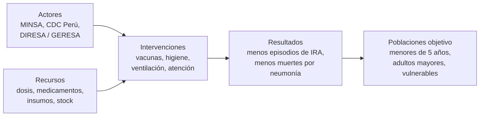
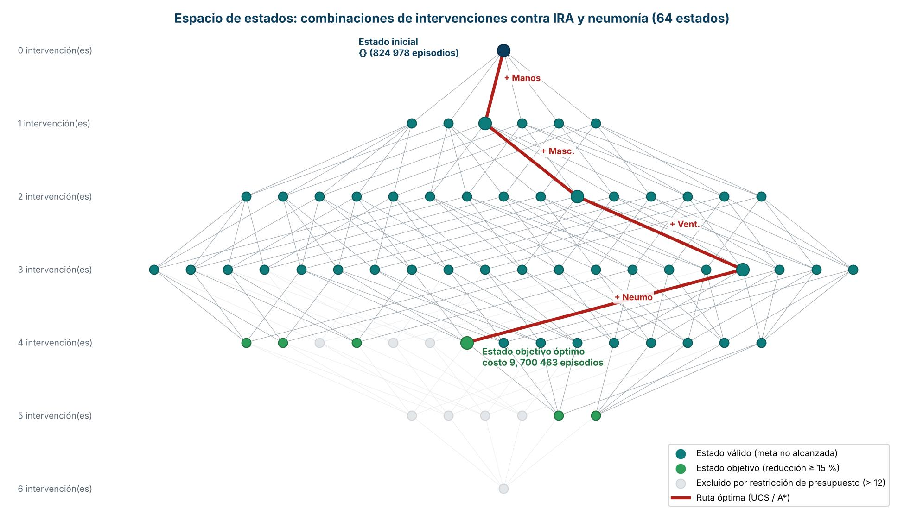

# Challenge 2 (Individual): Pipeline de Machine Learning
### Caso Tipo B: Infecciones Respiratorias Agudas (IRA) y Neumonía en menores de 5 años en el Perú

**Curso:** Machine Learning, Fundamentos de Machine Learning
**Docente:** Yannick Patrick Carrasco Merma
**Universidad Peruana Cayetano Heredia**

---

## 1. Presentación del Caso y Problema

### 1.1 Información del caso (Anexo del Examen Parcial)

| Dimensión | Datos reportados en la infografía |
|---|---|
| **Episodios de IRA** (menores de 5 años) | 2023: 1 003 178 · 2024: 883 959 · 2025: 824 978 |
| **Variación** | −7 % (2025 vs. 2024) y −18 % (2025 vs. 2023) |
| **Defunciones por neumonía** (menores de 5 años) | 2023: 113 · 2024: 82 · 2025: 51 |
| **Actores** | MINSA, CDC Perú, Direcciones Regionales de Salud, Gerencias Regionales de Salud |
| **Poblaciones objetivo** | Niños menores de 5 años, adultos mayores, poblaciones vulnerables |
| **Intervenciones** | Vacunación contra neumococo e influenza, lavado de manos, mascarilla ante síntomas, ventilación de ambientes, atención oportuna en centros de salud, campaña "Abrigamos vidas" |
| **Recursos** | 2 226 142 dosis de vacuna contra neumococo; 8.2 millones de dosis contra influenza (2.2 millones pediátricas y 6 millones para adultos); medicamentos, insumos, stock de contingencia y reabastecimiento regional |
| **No reportado** | Cobertura real de vacunación, distribución regional de casos y fallecimientos, costos de las intervenciones, impacto individual de cada medida, factores climáticos y socioeconómicos, relación causal demostrada |

### 1.2 Problema formulado

> La infografía muestra una tendencia favorable (menos episodios de IRA y menos muertes por neumonía), pero **no informa qué combinación de intervenciones explica o puede sostener esa mejora, ni cuánto cuesta cada una**. Con recursos limitados, **¿qué combinación de intervenciones conviene priorizar para lograr una reducción adicional del 15 % de los episodios de IRA (de 824 978 a ≤ 701 231) al menor costo posible, y cómo se puede predecir la tasa de episodios a partir de variables como cobertura de vacunación y clima?**

### 1.3 Por qué puede abordarse con IA y Machine Learning

| Sub-problema | Enfoque | Justificación |
|---|---|---|
| Elegir qué intervenciones activar con recursos limitados | **Búsqueda en espacios de estados** (BFS, UCS, A\*) | Es un problema de decisión discreto: cada combinación de intervenciones es un estado con costo y efecto. La cantidad de combinaciones crece como 2ⁿ y una IA las explora de forma sistemática y trazable. |
| Predecir la tasa de episodios de IRA según cobertura, clima y otros factores | **Regresión (aprendizaje supervisado)** | La infografía solo da 3 totales anuales y señala como vacíos la distribución regional y los factores climáticos y socioeconómicos. Un modelo de regresión permite cuantificar cómo se asocia cada variable con la tasa de episodios y simular escenarios. |

Un modelo de IA **no sustituye** la evaluación epidemiológica. La infografía advierte que la relación causal no está demostrada, por lo que los resultados de este repositorio son un **ejercicio de apoyo a la decisión con supuestos explícitos**.

---

## 2. Espacio de Estados

### 2.1 Modelo conceptual

| Elemento | Definición en el caso |
|---|---|
| **Estado** | Subconjunto de intervenciones activas, con su riesgo residual: `s = (I, E, C)`, donde `I` es el conjunto de intervenciones activas, `E` los episodios de IRA estimados y `C` el costo acumulado |
| **Estado inicial** | `I = {}`, `E = 824 978` (episodios de 2025), `C = 0` |
| **Operadores** | `activar(k)`: activar una intervención `k` que aún no esté activa. Hay 6 operadores: vacuna neumococo, vacuna influenza, lavado de manos, mascarilla, ventilación y atención oportuna |
| **Modelo de transición** | `activar(k)` agrega `k` a `I`, multiplica `E` por el factor de riesgo residual de `k` y suma su costo a `C` |
| **Test de objetivo** | `E ≤ 701 231` (reducción adicional ≥ 15 %) |
| **Costo de camino** | Suma de costos relativos de las intervenciones activadas |
| **Restricciones** | (1) cada intervención se activa una sola vez; (2) presupuesto máximo `C ≤ 12` unidades relativas; (3) las dosis de vacuna son finitas (2 226 142 de neumococo y 8.2 millones de influenza), por lo que no se activan más allá de la disponibilidad; (4) el efecto de las intervenciones se combina de forma multiplicativa |

**Parámetros asumidos** (la infografía no reporta costos ni efectos individuales; son hipótesis didácticas):

| Intervención | Factor de riesgo residual | Costo relativo |
|---|---|---|
| Vacuna neumococo | 0.94 | 5 |
| Vacuna influenza | 0.95 | 4 |
| Lavado de manos | 0.96 | 1 |
| Mascarilla ante síntomas | 0.97 | 1 |
| Ventilación de ambientes | 0.97 | 2 |
| Atención oportuna | 0.98 | 3 |

### 2.2 Representación visual

- **64 estados** (2⁶ combinaciones); **56** quedan dentro del presupuesto y **6** cumplen la meta.
- El grafo se organiza por niveles según el número de intervenciones activas. En rojo se marca la ruta óptima.

### 2.3 Resultado de la búsqueda (resumen)

| Estrategia | Intervenciones elegidas | Costo | Episodios estimados | Nodos expandidos |
|---|---|---|---|---|
| BFS | Neumococo, influenza, lavado de manos, mascarilla | 11 | 686 020 | 43 |
| UCS | Lavado de manos, mascarilla, ventilación, neumococo | **9** | 700 463 | 39 |
| A\* | Lavado de manos, mascarilla, ventilación, neumococo | **9** | 700 463 | **32** |

BFS minimiza el número de intervenciones, no el costo. UCS y A\* encuentran el costo mínimo y A\* expande menos nodos gracias a su heurística admisible.

---

## 3. Contenido del repositorio

| Archivo | Contenido | Corresponde a |
|---|---|---|
| `README.md` | Caso, problema y espacio de estados | Presentación del Caso y Problema / Espacio de Estados |
| `datos_caso_ira.txt` | Datos del anexo transcritos | Presentación del Caso y Problema |
| `espacio_de_estados.jpeg` | Representación visual de los 64 estados | Espacio de Estados |
| `01_Pipeline_Razonamiento_Busqueda.ipynb` | Problema → Espacio de Estados → Exploración → Búsqueda → Resultado | Pipeline Razonamiento, Búsqueda y Resultados |
| `02_Pipeline_Modelo_Prediccion.ipynb` | Datos sintéticos → regresión → gráfico interpretativo | Pipeline Modelo de Predicción y Visualización |

### Cómo ejecutar

1. Abre cada `.ipynb` en [Google Colab](https://colab.research.google.com) (`Archivo → Abrir cuaderno → GitHub`, pegando la URL del repositorio).
2. Ejecuta todas las celdas en orden. No se necesitan archivos externos: los datos se generan dentro del notebook.
